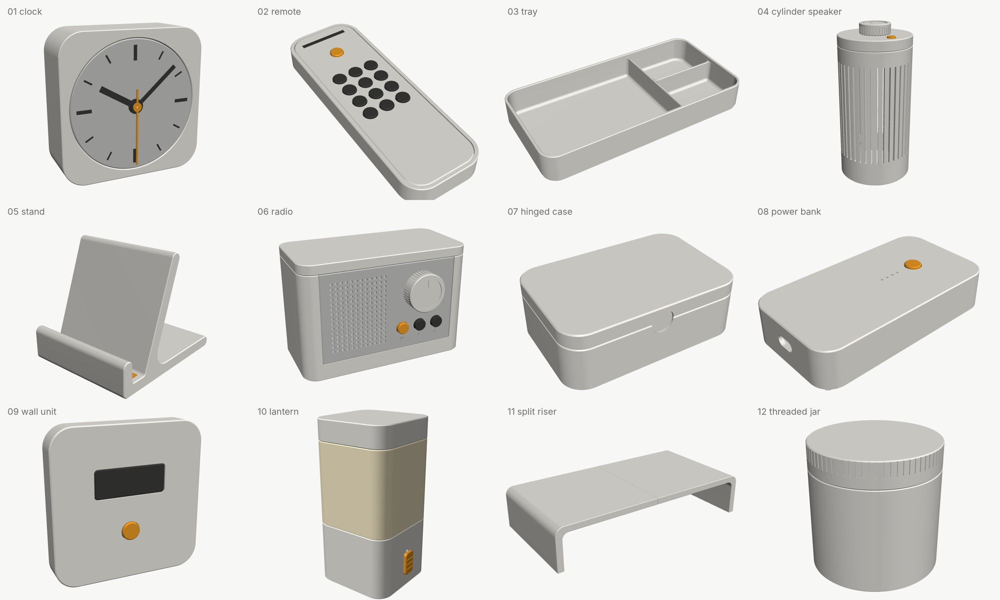

# fdm-minimal-design

fdm-minimal-design は、FDM の 3D プリント向けにミニマルな物を設計するエージェントのスキル。造形言語は、1960〜70 年代の
Braun 製品（その多くを Dieter Rams がデザインした）に着想を得ている。サンプルのモデルも入っている。

**サイト: https://fdm-minimal-design.koeda.me** — すべてのモデルを 3D で見られ、STEP と造形向きの STL をダウンロードできる。

[English](README.md)



このスキルは Claude に、ひとつの造形言語（平面は大きな R・稜線はシャープ、グリッド、無彩色＋アクセント 1 色、同一形状の反復）と、
それを FDM の制約に合わせるやり方を教える。

## できること

- **助言**: 自分の CAD で作る物について、グリッド・比率・R・面取り・造形向き・部品分割を数値で答える
- **3D モデルを作る**: [CadQuery](https://github.com/CadQuery/cadquery) で、造形向きに置いた部品ごとの STL・色付きの STEP アセンブリ・プレビュー画像・HTML の 3D ビューワーを出す
- **レビュー**: 寸法の根拠表 → Do/Don'ts → 使用状態 → 数値の検証 → 描画、の決まった手順で設計を見る

中身:

| | |
|---|---|
| `references/` | 原則、数値つきの設計ルール、Do/Don'ts、レビュー手順、サンプルのカタログ（英語） |
| `scripts/fdm_samples.py` | ヘルパーのライブラリと 12 種のサンプル（時計・リモコン・トレイ・スピーカー・スタンド・ラジオ・ヒンジケース・モバイルバッテリー・壁付け機器・ランタン・分割ライザー・ねじ蓋の容器） |
| `scripts/verify.py` | 数値の検証: ソリッドの有効性・干渉・メッシュの閉じ・ベッドに収まるか・接地・ヒンジの開き角とスライドの移動量 |
| `scripts/render.py` | プレビュー画像（VTK のオフスクリーン描画） |
| `scripts/viewer.py` | オフラインで開ける 1 ファイルの HTML の 3D ビューワー（組み付けた状態と造形向きの配置・部品の表示と半透明の切り替え（部品の一覧から、または部品をクリックして）・分解図・寸法・部品の一覧） |
| `scripts/template_new_object.py` | 新しい物を作るときのひな形 |
| `assets/` | 図とサンプルのプレビュー（`.skill` にはサンプルの STEP も入る） |

スキルの本文は英語。日本語で頼んでも使える。

## 入れ方

### Claude Code

スキルのフォルダーを skills のディレクトリにコピーする。

```bash
git clone https://github.com/koedame/fdm-minimal-design-skill.git
cp -r fdm-minimal-design-skill/skills/fdm-minimal-design ~/.claude/skills/
```

そのプロジェクトだけで使うなら、`~/.claude/skills/` の代わりにプロジェクトの `.claude/skills/` に置く。
リポジトリのフォルダーには STEP が入っていない。CadQuery が入っていれば、Claude が `scripts/fdm_samples.py` で作れる（[環境](#環境)）。

### Claude.ai

1. `fdm-minimal-design.skill` を用意する（[.skill の作り方](#skill-の作り方)）。中身は ZIP なので、アップロードの画面が受け付けなければ `fdm-minimal-design.zip` に名前を変える
2. コード実行を有効にしておく: **Settings → Capabilities**
3. **Customize → Skills** を開き、**+** → **Create skill** → **Upload a skill** でファイルを上げる

## 環境

スクリプトには Python 3.11 以上が要る。確かめた版は `requirements.txt` に固定してある。
Linux では、CadQuery に OpenGL ライブラリ（`libGL.so.1`）とフォント（サンプルが文字を彫る）が要り、画面の無い環境では `render.py` に OSMesa か EGL が要る。
Debian・Ubuntu なら `sudo apt-get install libgl1 libosmesa6 fonts-dejavu-core`。デスクトップ環境には普通入っているが、最小のイメージやコンテナには入っていない。

```bash
python -m venv .venv
. .venv/bin/activate
pip install -r requirements.txt

python skills/fdm-minimal-design/scripts/fdm_samples.py --out out     # 全サンプルの STL と STEP
python skills/fdm-minimal-design/scripts/verify.py --all
python skills/fdm-minimal-design/scripts/render.py --all --out previews
python skills/fdm-minimal-design/scripts/viewer.py --all --out viewers  # サンプルごとに HTML を 1 つ
```

## .skill の作り方

```bash
python tools/build_skill.py              # dist/fdm-minimal-design.skill（サンプルの STEP 入り）
python tools/build_skill.py --no-step    # STEP なし（CadQuery が要らない）
```

CI がプルリクエストごとに同じファイルを作り、ワークフローの成果物として残す。

## サイトの作り方

```bash
python tools/build_site.py --out build/site                       # models/ の全モデルと 12 のサンプル
python tools/build_site.py --out build/site 001_pen_cup 06_radio  # 指定したものだけ
```

静的なサイトを書き出す。スキルを紹介してモデル・サンプルを並べるトップページと、1 つずつのページ（`/models/<id>/`）で、
後者には部品・ダウンロード（STEP・造形向きの STL の zip・ビューワーの HTML）と、`viewer.py` のビューワーによる 3D 表示が載る。
ページごとに検索エンジンと共有のリンク向けのタイトル・説明・プレビュー画像を持ち、JavaScript が無くても中身が読める。一覧は `sitemap.xml` にも出す。
エージェント向けに、ページごとの Markdown 版（隣の `index.md`。ページの head で示す）と schema.org の構造化データ（JSON-LD）を持ち、`llms.txt` に Markdown 版を並べる。`robots.txt` では、検索と AI の回答には使ってよく、AI の学習には使わないでほしいことを示す（Content-Signal）。
一覧は `models/` から組むので、モデルを足してもサイトの手直しは要らない。
ページは外のサーバーから何も読まない。フォルダーには、応答ヘッダーを決める `_headers`（サイト自身のファイルだけを許す Content Security Policy と、`/downloads/` の下を添付として送る指定）・`404.html`・`.well-known/security.txt` も入る。
`<dir>/` に `<dir>/index.html` を返す静的なホスティングにフォルダーをそのまま置く。手元で見るときは `python -m http.server -d build/site`
（ファイルを直に開くと 3D 表示は読み込めない）。CI がプルリクエストごとに組み、ワークフローの成果物として残す。

## リポジトリの構成

```
skills/fdm-minimal-design/   スキル本体（SKILL.md・references・scripts・assets）
models/                      スキルで設計したモデル。1 モデル 1 ディレクトリ（形は models/README.md）
site/                        サイトのページとスクリプト（tools/build_site.py が組む）
tools/                       build_skill.py（.skill を組む）、models.py（models/ の検査と書き出し）、
                             build_site.py（サイトを組む）、build_three.sh（ビューワーに入れる three.js を組む）
tests/                       道具のテスト（pytest）とビューワーの操作の入力のテスト（node --test tests/js/*.test.mjs）
```

生成物の 3D ファイル（STEP・STL）はコミットしない。スクリプトから作り直せるので、`.skill` とリリースで配る。モデルが増えてもクローンが重くならない。

## ライセンス

- **コードとスキルの文書 — [MIT](LICENSE)。** Python のファイル（`*.py`）、ビューワー（`scripts/viewer/`）、サイト（`site/`）、`SKILL.md`、`references/`、README などの文書
- **3D モデルと画像 — [CC BY 4.0](LICENSE-CC-BY-4.0.txt)。** このリポジトリから公開する STEP・STL などのモデルのファイル（サンプルと `models/` から生成したものを含む）と、すべての画像（PNG・SVG）。
  表示は「fdm-minimal-design by koedame, CC BY 4.0」とし、このリポジトリへのリンクと、変更したならその旨を添える
- **three.js** — `scripts/viewer/three.min.js` は [three.js](https://github.com/mrdoob/three.js) 0.187.0 を組んだもの。
  © three.js authors、MIT ライセンス（[本文](skills/fdm-minimal-design/scripts/viewer/three-LICENSE.txt)）。`viewer.py` が書き出すページには、ライセンスの本文ごと入る

## 無保証と安全について

モデルと道具は、非商業のプロジェクトとして無償で配っている。ここにある物を売ったり、広告を載せたり、収益を得たりはしない。

すべて現状のまま提供し、保証はしない（各ライセンスを参照）。特に:

- 寸法（クリアランス・スナップ・ネジ・穴）は経験的な目安で、**サンプルは実機で印刷していない**。全体を印刷する前に、嵌合部だけのテストピースで確かめること
- **印刷した部品は、どんな用途の認証も受けていない。** 電池や LED を入れる物、熱を持つ物、食品に触れる物では、印刷した部品の安全を保証しない。電子部品（電池・充電器・LED ドライバー・電源）は認証済みの物を使い、材料と電気の設計は自分で確かめること
- 印刷した部品は試験を経た製品ではない。強度・耐熱・食品への安全は、プリンター・材料・設定で変わる。壊れると人がけがをする所に頼らないこと。材料と工程を自分で確かめていない限り、食品に触れる用途に使わないこと。電池・充電器・LED モジュールは認証済みの物だけを使い、その製造元の説明に従うこと。小さな部品は幼い子どもの手の届かない所に置くこと

## 貢献

Issue とプルリクエストを歓迎する。貢献は、変えた部分のライセンス（コードと文書は MIT、モデルと画像は CC BY 4.0）で公開する。自分で作り、そのライセンスで公開してよいものだけを出すこと。新しいモデルはオリジナルの設計にし、特定の製品の形・名前・ロゴを写さないこと。CI（`.github/workflows/ci.yml` と同じ検査）が通ること。詳しくは [CONTRIBUTING.md](CONTRIBUTING.md)（英語）。

## セキュリティ

脆弱性は公開の Issue でなく、[SECURITY.md](SECURITY.md) のとおり非公開で知らせてほしい。

## 独立したプロジェクトであること

このプロジェクトは独立したもので、Braun、The Procter & Gamble Company、De'Longhi、Vitsœ、Dieter Rams のいずれとも関係がなく、
承認や後援も受けていない。「Braun」はその権利者の商標で、歴史的な様式を説明するためにだけ名前を出している。
スキルとモデルは、特定の Braun 製品・ロゴ・外観を再現していない。

FDM は Stratasys の登録商標で、ここでは造形方式の一般的な呼び名としてだけ使っている。
