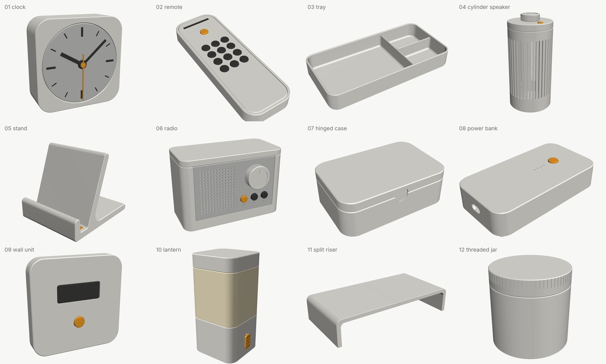

# fdm-minimal-design

fdm-minimal-design is an agent skill for designing minimalist objects for FDM 3D printing. Its design language is
inspired by the consumer products Braun made in the 1960s and 1970s, many of them designed by Dieter Rams. The
repository also holds example models.

[日本語](README.ja.md)



The skill teaches Claude a design language — large radii in plan with sharp edges, a grid, achromatic colours with a
single accent, repetition of one shape — and how to fit it to the constraints of FDM printing.

## What it does

- **Advises** on an object you model yourself: grid, proportions, radii, chamfers, print orientation, part split, with numbers.
- **Builds** 3D models with [CadQuery](https://github.com/CadQuery/cadquery): STL per part in print orientation, a coloured STEP assembly, preview images and an HTML 3D viewer.
- **Reviews** a design with a fixed procedure: a dimension rationale table, Dos and Don'ts, use cases, numeric checks and a rendering.

It comes with:

| | |
|---|---|
| `references/` | Principles, numeric design rules, Dos and Don'ts, the review procedure and a catalogue of the samples |
| `scripts/fdm_samples.py` | A helper library and 12 sample objects (clock, remote, tray, speaker, stand, radio, hinged case, power bank, wall unit, lantern, split riser, threaded jar) |
| `scripts/verify.py` | Numeric checks: solid validity, interference, watertight meshes, bed fit, ground contact, hinge sweep |
| `scripts/render.py` | Preview images (VTK, off-screen) |
| `scripts/viewer.py` | An interactive 3D viewer as one HTML file that opens offline (assembled and print layout, part visibility, exploded view, dimensions, parts table) |
| `scripts/template_new_object.py` | The starting point for a new object |
| `assets/` | Figures and the sample previews (the `.skill` bundle also holds the sample STEP files) |

## Install

### Claude Code

Copy the skill folder into your skills directory:

```bash
git clone https://github.com/koedame/fdm-minimal-design-skill.git
cp -r fdm-minimal-design-skill/skills/fdm-minimal-design ~/.claude/skills/
```

Use `.claude/skills/` inside a project instead of `~/.claude/skills/` to install it for that project only.
The folder from the repository has no STEP files; Claude can generate them with `scripts/fdm_samples.py` when CadQuery
is installed (see [Environment](#environment)).

### Claude.ai

1. Get `fdm-minimal-design.skill` (see [Building the .skill file](#building-the-skill-file)). It is a ZIP file;
   rename it to `fdm-minimal-design.zip` if the upload dialog does not accept it.
2. Code execution must be on: **Settings → Capabilities**.
3. Open **Customize → Skills**, click **+**, choose **Create skill → Upload a skill**, and upload the file.

## Environment

The scripts need Python 3.11 or later. The tested versions are pinned in `requirements.txt`.
On Linux without a display, `render.py` needs OSMesa or EGL (`sudo apt-get install libosmesa6` on Debian and Ubuntu).

```bash
python -m venv .venv
. .venv/bin/activate
pip install -r requirements.txt

python skills/fdm-minimal-design/scripts/fdm_samples.py --out out     # STL + STEP for all samples
python skills/fdm-minimal-design/scripts/verify.py --all
python skills/fdm-minimal-design/scripts/render.py --all --out previews
python skills/fdm-minimal-design/scripts/viewer.py --all --out viewers  # one HTML file per sample
```

## Building the .skill file

```bash
python tools/build_skill.py              # dist/fdm-minimal-design.skill, with the sample STEP files
python tools/build_skill.py --no-step    # without STEP (no CadQuery needed)
```

CI builds the same file on every pull request and keeps it as a workflow artifact.

## Building the website

```bash
python tools/build_site.py --out build/site                       # every model in models/ and the 12 samples
python tools/build_site.py --out build/site 001_pen_cup 06_radio  # only these
```

writes one static page that introduces the skill and lists the models and samples; selecting one shows it in 3D
with the viewer of `viewer.py`, with its STEP, print STLs (zip) and viewer HTML to download. The list is built from
`models/`, so a new model needs no change to the site. The page reads nothing from other servers. Serve the folder
from any static host; to look at it locally, `python -m http.server -d build/site` (opening `index.html` as a file
does not load the 3D view). CI builds it on every pull request and keeps it as a workflow artifact.

## Repository layout

```
skills/fdm-minimal-design/   the skill (SKILL.md, references, scripts, assets)
models/                      models designed with the skill, one directory each (format: models/README.md)
site/                        the page of the website and its script (built by tools/build_site.py)
tools/                       build_skill.py (the .skill bundle), models.py (check and export models/),
                             build_site.py (the website), build_three.sh (the three.js bundle of the viewer)
tests/                       tests for the tools (pytest) and for the viewer's input handling (node --test tests/js/*.test.mjs)
```

Generated 3D files (STEP, STL) are not committed. They are regenerated from the scripts and published through the
`.skill` bundle and releases, which keeps clones small as the number of models grows.

## Licence

- **Code and skill documents — [MIT](LICENSE).** Python files (`*.py`), the viewer (`scripts/viewer/`), the website (`site/`), `SKILL.md`,
  `references/`, the READMEs and other documentation.
- **3D models and images — [CC BY 4.0](LICENSE-CC-BY-4.0.txt).** STEP, STL and other model files published from this
  repository (including those generated from the samples and from `models/`), and all images (PNG, SVG).
  Attribute as "fdm-minimal-design by koedame, CC BY 4.0", link to this repository and say if you changed anything.
- **three.js** — `scripts/viewer/three.min.js` is a build of [three.js](https://github.com/mrdoob/three.js) 0.187.0,
  © three.js authors, under the MIT licence ([text](skills/fdm-minimal-design/scripts/viewer/three-LICENSE.txt)).
  Every page written by `viewer.py` contains it with its licence.

## No warranty and safety

Everything here is provided as is, without warranty (see the licences). In particular:

- The dimensions (clearances, snaps, threads, holes) are rules of thumb and **the samples have not been printed on a
  real printer**. Print a test piece of the mating features before printing a whole object.
- **Printed parts are not certified for anything.** For objects that hold batteries or LEDs, get hot, or touch food,
  the safety of the printed parts is not guaranteed. Use certified electronic components (batteries, chargers, LED
  drivers, power supplies) and check the materials and the electrical design yourself.

## Independent project

This is an independent project. It is not affiliated with, endorsed by, or sponsored by Braun, The Procter & Gamble
Company, De'Longhi, Vitsœ, or Dieter Rams. "Braun" is a trademark of its respective owner and is used here only to
describe a historical design style. The skill and the models do not reproduce any specific Braun product, logo, or
trade dress.
